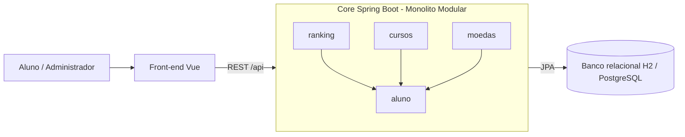
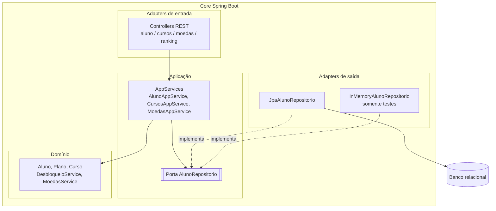
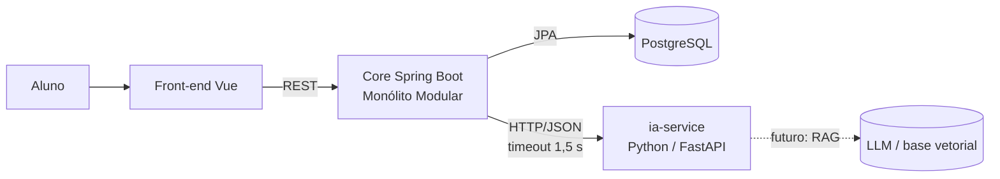
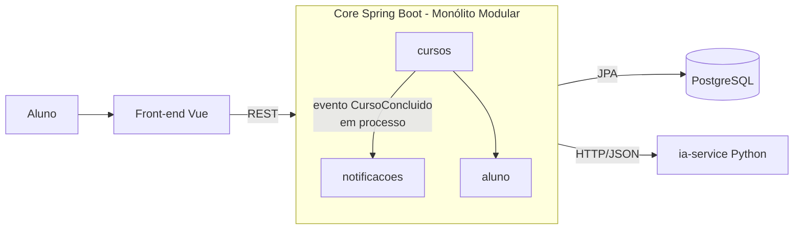
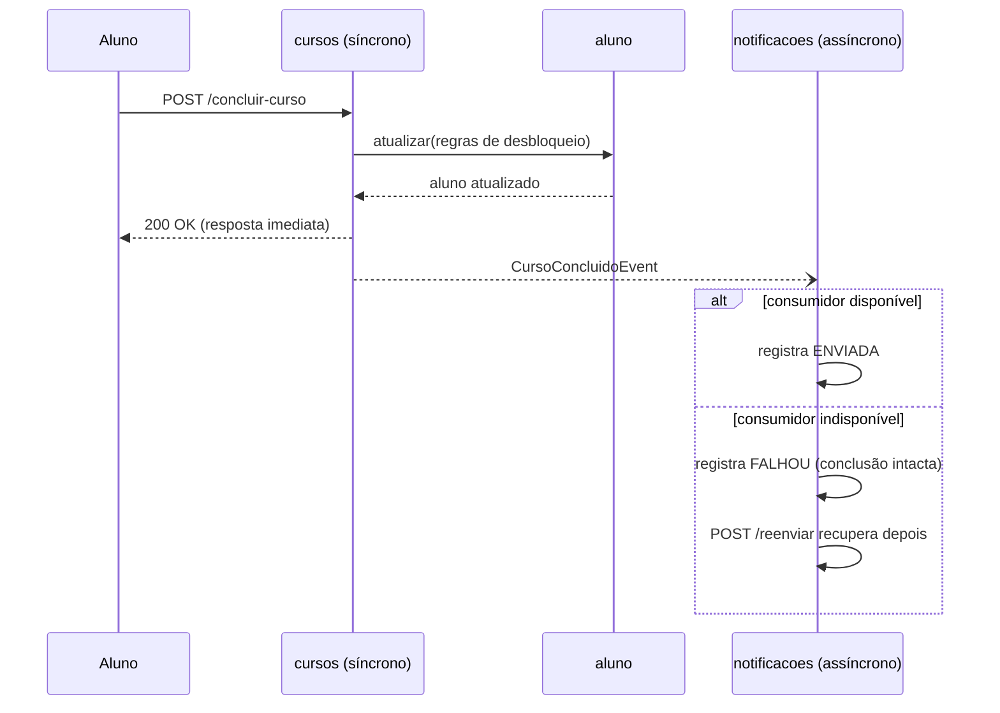

# Registro Arquitetural — Grupo 4 GameEducator (B1 · Architecture Lab)

Registro cumulativo. Cada desafio acrescenta uma seção. Regra de leitura de trás para frente:
**C4 ← ADR ← ASR + RPC ← RF/RNF**, com a evidência sustentando o raciocínio.

- Equipe: Fernanda Theodoro Casali- 235329 /
  Carolina Leamari - 235249 /
  Eduarda Gomes Abreu e Almeida - 236021
- Repositório: https://github.com/FernandaCasali/Grupo_4_GameEducator.git
- Branch do B1: `b1-architecture-lab`

---

## Matriz cumulativa de ASRs

| ASR | D1 Core | D2 Organização | D3 IA | D4 Eventos | D5 IoT | D6 CI/CD |
|---|---|---|---|---|---|---|
| Manutenibilidade | ✅ | ✅ | | | | |
| Escalabilidade | ✅ | | | | | |
| Complexidade operacional | ✅ | | | | | |
| Testabilidade | | ✅ | | | | |
| Modificabilidade | | ✅ | | | | |
| Deploy independente | | | ✅ | | | |
| Tolerância a falhas | | | ✅ | ✅ | | |
| Interoperabilidade | | | ✅ | | | |
| Desacoplamento | | | | ✅ | | |
| Recuperabilidade | | | | ✅ | | |

## Índice de ADRs

| ADR | Decisão | Desafio |
|---|---|---|
| ADR-001 | Monólito Modular | D1 |
| ADR-002 | Ports & Adapters no módulo `aluno` (persistência atrás de porta) | D2 |
| ADR-003 | Serviço Python independente (FastAPI) para IA, com degradação | D3 |
| ADR-004 | Eventos de domínio em processo + consumidor assíncrono (sem broker agora) | D4 |

---

# Desafio 1 — Drivers e evolução do Core

## 1. Cenário

O MVP de gamificação (AC1) passa de ~1.000 para até 100.000 usuários. O ranking tende a crescer mais que
as demais capacidades; moedas, desbloqueio de cursos e conversão em cripto continuam evoluindo.
Pergunta do Tech Lead: **há evidência para distribuição e deploy independente agora, ou uma
modularização interna resolve com menor custo operacional?**

## 2. RF afetados

| ID | Requisito | Onde está no código |
|---|---|---|
| RF01 | Ranking de alunos | **Novo** neste desafio: módulo `ranking` (`GET /api/ranking`) |
| RF02 | Conquistas / gamificação | Moedas por engajamento (US1), desbloqueio de cursos (US2), conversão em cripto (US3) |

## 3. RNF e seleção de ASRs

| RNF | ASR? | Justificativa |
|---|---|---|
| Manutenibilidade | **SIM** | As regras de moedas, desbloqueio e ranking mudam em ritmos diferentes; hoje estão misturadas no mesmo serviço (`AlunoService`/`AlunoAppService`). Fronteiras explícitas reduzem o impacto de mudança. |
| Escalabilidade | **SIM** | O Ranking é leitura que cresce mais que o resto; a estrutura precisa deixá-lo isolável para escalar à parte, se um dia for preciso. |
| Complexidade operacional | **SIM** | Equipe de 6 pessoas; microsserviços trariam rede, contratos, observabilidade e deploys múltiplos sem evidência de necessidade. |
| Desempenho | NÃO, agora | Relevante, mas não há medição de latência/throughput que prove gargalo arquitetural. |
| Testabilidade | NÃO como driver | Melhora com módulos, mas sozinha não decide a decomposição. |

## 4. RPC — restrições e premissas

| RPC | Consequência |
|---|---|
| Core em Java 21 / Spring Boot | Evolução preserva o investimento; sem troca de stack. |
| Equipe de 6 desenvolvedores | Complexidade operacional proporcional à equipe. |
| Banco relacional (H2 dev / PostgreSQL) | Sem troca de tecnologia de dados por modernização. |
| Legado da AC1 (API `/api/alunos/**`, testes, front Vue) | Evolução incremental, sem reescrita; **URLs e contratos preservados**. |

## 5. Alternativas e trade-offs

| Alternativa | Benefícios | Custos / riscos | Avaliação |
|---|---|---|---|
| A — Monólito em Camadas (estado atual) | Zero custo de mudança; operação simples. | Três capacidades no mesmo `AlunoService`/`AlunoAppService`; regra Premium duplicada; Ranking nasceria espalhado em 4 camadas. | Possível, mas despreparada para a evolução prevista. |
| **B — Monólito Modular** | Fronteiras por capacidade; um único deploy; testes por módulo; extração futura do Ranking facilitada. | Mesmo processo e mesmo banco; escala e deploy ainda conjuntos. | **Melhor equilíbrio entre ASRs e RPCs.** |
| C — Serviço(s) independente(s) (ex.: Ranking) | Escala e deploy independentes. | Rede, contratos, consistência, observabilidade, mais pipelines. | Prematuro: nada prova necessidade de escala/deploy independente. |

## 6. Decisão do Tech Lead

**Evoluir o Core para Monólito Modular**, organizado por capacidade de negócio:
`aluno` (cadastro e agregado), `cursos` (desbloqueio), `moedas` (engajamento e cripto) e `ranking` (RF01).
Continua um único processo Spring Boot, um banco e um deploy. O Ranking é **candidato explícito à extração futura**,
mas não vira serviço agora.

## 7. ADR-001 — Evoluir o Core de Monólito em Camadas para Monólito Modular

| Campo | Registro |
|---|---|
| Status | Aceito |
| Contexto | Crescimento para até 100 mil usuários; Ranking cresce mais; demais capacidades evoluem. A AC1 concentra moedas, desbloqueio e cripto em `AlunoService` e `AlunoAppService`. |
| ASRs | Manutenibilidade; Escalabilidade; Complexidade operacional. |
| RPCs | Java 21/Spring Boot; equipe de 6; banco relacional; legado da AC1 com contratos HTTP preservados. |
| Alternativas | A) Camadas; B) Modular; C) Serviços independentes. |
| Decisão | Adotar Monólito Modular. Módulos conversam apenas por contratos públicos (`api`); `internal` é privado ao módulo. |
| Consequências positivas | Responsabilidades separadas; regra Premium em um só lugar (`Aluno.isPremium()`); Ranking isolado e testável; fronteiras verificadas por teste (ArchUnit); custo operacional igual ao atual. |
| Trade-offs | Deploy ainda conjunto; processo e banco compartilhados; Ranking sem escala independente; `Aluno`, `Curso` e `Plano` ficam em `aluno.domain` como núcleo compartilhado (shared kernel). |
| Gatilho de revisão | Reavaliar extração do Ranking se métricas mostrarem gargalo de leitura, necessidade de escala própria ou frequência de deploy conflitante. |

## 8. C4 — Container

O Core permanece **um único container**; a organização interna passa a ser modular.



Detalhamento dos componentes internos (e portas/adaptadores) fica para o Desafio 2.

## 9. Estrutura dos módulos

```
aluno/        api (AlunoController, AlunoGateway, DTOs) · application · domain (Aluno, Plano, Curso) · internal/persistence
cursos/       api (+ CursoConcluidoEvent) · application · domain (DesbloqueioService)
moedas/       api · application · domain (MoedasService)
ranking/      api · application · domain (PontuacaoRanking)       (D1, D2)
conquistas/   api · application · domain (Badge, RegrasConquistas) (D2, RF02)                                  (D1)
recomendacao/ api · application (porta) · internal (adapter HTTP)  (D3)
notificacoes/ api · application (porta) · internal (adapter)       (D4)
shared/       web (ApiExceptionHandler) · config (AsyncConfig)
```

Regras de dependência (verificadas em `arquitetura/FronteirasModulosTest`):

1. O pacote `internal` de cada módulo é privado ao módulo.
2. Sem ciclos entre módulos.
3. Cada módulo só conhece os módulos permitidos: `aluno` não conhece ninguém; `cursos`, `moedas`, `ranking` e `recomendacao` conhecem só `aluno` (via `AlunoGateway`); `notificacoes` conhece só o contrato público de `cursos` (o evento).

## 10. Mini-lab — evidência antes/depois

| Evidência | Antes (camadas) | Depois (modular) |
|---|---|---|
| Organização | `controller/ service/ domain/ entity/ repository/ dto/` | Por capacidade: `aluno`, `cursos`, `moedas`, `ranking` |
| `AlunoAppService` | Atende criar, listar, concluir curso, creditar moedas e converter cripto | Só cadastro/consulta + `atualizar(id, regra)`; regras ficam nos módulos |
| `AlunoService` (domínio) | Desbloqueio + moedas + cripto na mesma classe | `DesbloqueioService` e `MoedasService` separados |
| Regra Premium (12 cursos) | Duplicada em `AlunoService` e `AlunoAppService.toResponse` | Única, em `Aluno.isPremium()` |
| Dependências | Livres: qualquer classe usa qualquer outra | Explícitas e verificadas por teste |
| Testes | Um arquivo por camada, misturando capacidades | Testes por módulo; Ranking com testes próprios |
| Extrair o Ranking | Exigiria separar 4 camadas | Depende só de `AlunoGateway` |

Arquivos de apoio:

- `evidencias/antes-estrutura.txt` e `evidencias/depois-estrutura.txt` — árvore de classes.
- `evidencias/depois-testes.txt` — árvore de testes.
- `evidencias/` — **colar aqui** a saída do `mvn test` e o relatório JaCoCo após rodar (ver abaixo).


**Ranking (RF01) funcionando:**


### Como reproduzir

```bash
cd backend
mvn test                 # inclui testes de módulos e FronteirasModulosTest
mvn spring-boot:run      # GET http://localhost:8080/api/ranking
```

Preservação de comportamento (a comprovar com o `mvn test`): endpoints `/api/alunos/**` mantidos com os mesmos caminhos, e os testes da AC1
foram redistribuídos por módulo sem alterar as regras testadas.

## 11. Conclusão

A equipe decidiu evoluir o Core para Monólito Modular. A refatoração separou as capacidades sem introduzir
comunicação distribuída e sem alterar os endpoints existentes, e o RF01 (Ranking) entrou já dentro de um módulo
isolado. A extração do Ranking para serviço não foi adotada porque o cenário informa crescimento, mas não há
evidência de gargalo ou de necessidade de deploy independente. **Ainda precisa ser medido** antes de extrair:
latência e throughput de `GET /api/ranking` sob carga, e frequência de mudança do módulo.

## 12. Rastreabilidade

| Elemento | Resposta |
|---|---|
| RF | RF01 Ranking; RF02 Conquistas (moedas, desbloqueio, cripto) |
| RNF | Manutenibilidade, escalabilidade, complexidade operacional, desempenho, testabilidade |
| ASR | Manutenibilidade; escalabilidade; complexidade operacional |
| RPC | Spring Boot; equipe de 6; banco relacional; legado AC1 |
| Alternativas | Camadas × Modular × Serviços |
| ADR | ADR-001 — Monólito Modular |
| C4 | Container: Core único com módulos internos |
| Evidência | Refatoração por módulo + Ranking + testes + ArchUnit + antes/depois |

> **Observações para a equipe:** (1) a pontuação do Ranking (`100 × totalCursos + moedas`) é uma regra didática
> adotada pelo grupo, ajustem se o professor definir outra; (2) a saída real do `mvn test` precisa ser anexada,
> este documento não afirma resultado de execução.

---

# Desafio 2 — Organização interna do Core

## 1. Cenário

As regras de ranking, moedas, badges e recompensas mudam com frequência. É preciso evitar que domínio,
banco, framework e integrações fiquem fortemente acoplados.

Diagnóstico no código (antes do D2): `AlunoAppService` dependia diretamente de `AlunoRepository` (Spring Data)
e de `AlunoEntity` (JPA), e carregava a tradução entidade ↔ domínio. Para testar um caso de uso era
preciso simular o repositório JPA com Mockito.

## 2. RF afetados

RF01 Ranking; RF02 Conquistas e regras de gamificação.

## 3. RNF e seleção de ASRs

| RNF | ASR? | Como altera a arquitetura |
|---|---|---|
| Testabilidade | **SIM** | Casos de uso precisam rodar sem banco nem framework; isso decide **de que a aplicação pode depender** (porta, não JPA). |
| Modificabilidade | **SIM** | Trocar persistência ou regra não pode se espalhar; define **onde ficam as fronteiras** entre domínio, aplicação e adapters. |
| Manutenibilidade | **SIM** | Regras mudam com frequência; precisam viver em classes sem dependência técnica. |
| Facilidade de evolução | incorporada à modificabilidade | Mesmo efeito estrutural. |

## 4. RPC

Core continua Spring Boot; regras existentes (`DesbloqueioService`, `MoedasService`) são reaproveitadas;
**não** se reescreve o produto para aplicar um padrão.

## 5. Decisão do Tech Lead

- **Qual dependência precisa ser invertida?** Somente a **persistência**: a aplicação passa a depender da
  porta `AlunoRepositorio`; o JPA vira detalhe (`JpaAlunoRepositorio`).
- **O que NÃO se inverte:** controllers/DTOs (adapter de entrada HTTP já fino) e as regras de domínio, que já eram classes puras.
- **O custo é proporcional?** Sim: 1 interface, 1 adapter JPA e 1 adapter fake; o mapeamento entidade ↔ domínio já existia e apenas mudou de lugar.
- **DDD, Hexagonal, Clean e Onion são concorrentes?** Não. Usamos **Hexagonal** como estrutura (portas e adapters), com **conceitos táticos de DDD**
  (agregado `Aluno`, serviços de domínio). Clean/Onion completos (um caso de uso por classe, camadas concêntricas formais) seriam excesso para este tamanho.

## 6. Alternativas e trade-offs

| Alternativa | Benefícios | Custos / riscos | Avaliação |
|---|---|---|---|
| A — Manter como está (app service usa JPA) | Nenhum custo. | Testes dependem de Mockito sobre repositório JPA; trocar persistência atinge casos de uso. | Rejeitada: não atende testabilidade/modificabilidade. |
| **B — Ports & Adapters (Hexagonal) no módulo `aluno`** | Aplicação isolada de JPA; adapter fake para testes; regra verificável por ArchUnit. | Uma indireção a mais; `atualizar` faz duas leituras (buscar + salvar). | **Escolhida.** |
| C — Clean/Onion completo | Máximo isolamento formal. | Muitas classes e mappers; esforço desproporcional ao problema. | Rejeitada: custo estrutural maior que o benefício. |

## 7. ADR-002 — Persistência atrás de porta no módulo `aluno`

| Campo | Registro |
|---|---|
| Status | Aceito |
| Contexto | Casos de uso dependiam de JPA; regras mudam com frequência; testar exigia mocks de infraestrutura. |
| ASRs / RPCs | Testabilidade, modificabilidade, manutenibilidade / Spring Boot, reaproveitar regras, sem reescrita. |
| Alternativas | A) manter; B) Ports & Adapters; C) Clean/Onion completo. |
| Decisão | Criar a porta `aluno.application.AlunoRepositorio`; mover o mapeamento para o adapter `JpaAlunoRepositorio`; adotar `InMemoryAlunoRepositorio` como adapter de teste. |
| Consequências positivas | `AlunoAppService`, `CursosAppService` e `MoedasAppService` testados sem Spring, JPA ou Mockito; domínio sem dependência de framework (verificado). |
| Aplicação a outras portas | O mesmo padrão aparece na IA (`RecomendadorPort`, ADR-003) e nas notificações (`NotificadorPort`, ADR-004) |
| Trade-offs | Indireção extra; duas leituras por atualização (aceitável no volume atual; revisar com métricas). |
| Gatilho de revisão | Se a duplicação de leituras aparecer em métricas de latência, otimizar o adapter sem tocar na porta. |

## 8. C4 — Component (Core)



## 9. Mini-lab / evidência

| Evidência | Resultado esperado |
|---|---|
| `InMemoryAlunoRepositorio` no lugar do JPA | `AlunoAppServiceTest`, `CursosAppServiceTest` e `MoedasAppServiceTest` passam **sem** Spring, JPA ou Mockito |
| `DesbloqueioServiceTest` e `MoedasServiceTest` (regras de domínio) | Continuam iguais: a regra foi isolada e reaproveitada |
| `JpaAlunoRepositorioTest` | Tradução entidade ↔ domínio (planos vazio/nulo, cursos, notificado) preservada |
| `FronteirasModulosTest` | Domínio não depende de Spring/JPA; aplicação não conhece adapters nem JPA |
| `PontuacaoRankingTest` (regra de ranking no domínio) | A fórmula do ranking é Java puro, testada sem Spring; trocar o peso afeta uma só classe |
| `RegrasConquistasTest` (badges, RF02) | A regra de conquistas é Java puro, testada sem Spring; novo badge ou limite afeta uma só classe |

## 10. Conclusão

A única inversão necessária era a de persistência. Ela foi feita com custo baixo, preservou as regras e os endpoints,
e tornou os casos de uso testáveis sem infraestrutura. **Falta medir:** o impacto das duas leituras por atualização.

---

# Desafio 3 — Serviço Python e IA

## 1. Cenário

A plataforma incorpora recomendação inteligente (RF03) e assistente educacional com RAG/LLM (RF04). Os modelos serão
em Python, com ciclo de atualização próprio e carga variável, e **podem ficar indisponíveis sem impedir operações essenciais**.

## 2. RF e RNF

RF03 Recomendação inteligente; RF04 Assistente educacional.

| RNF | ASR? | Como altera a arquitetura |
|---|---|---|
| Deploy independente | **SIM** | Modelos têm ciclo de atualização próprio; exige processo/artefato separado do Core Java. |
| Tolerância a falhas | **SIM** | A IA pode cair; define **comunicação com timeout, fallback e degradação** em vez de chamada direta sem proteção. |
| Interoperabilidade | **SIM** | Java ↔ Python exige contrato neutro de linguagem (HTTP/JSON), que fixa **o protocolo**. |
| Escalabilidade | não agora | Carga é variável, mas não há medição; a separação em serviço a habilita sem decidir nada além disso. |
| Desempenho | não agora | Sem medição de latência de inferência. |
| Manutenibilidade | atendida por consequência | — |

## 3. RPC

Core permanece Java/Spring Boot; ML/RAG em Python; indisponibilidade da IA não pode bloquear o fluxo essencial.

## 4. Decisão do Tech Lead

- **Python por si só justifica um serviço?** Não. O que justifica é a combinação **deploy independente + isolamento de falha + runtime e dependências diferentes**.
- **ML e RAG na mesma fronteira?** Por ora **um único `ia-service`**, com módulos internos separados por capacidade. Separar em dois serviços
  apenas se aparecerem ASRs distintos (ex.: RAG com LLM externo, alta latência e custo próprio, versus recomendação com re-treino periódico).
- **Comportamento degradado aceitável:** recomendação devolve lista vazia com `degradado=true` e `origem=FALLBACK_SEM_IA`; o assistente (RF04, ainda não implementado) responderia que está indisponível. Conclusão de curso, moedas, ranking e desbloqueio **não dependem da IA**.
- **Escopo implementado no lab:** somente RF03 (recomendação). O assistente RAG (RF04) **não foi implementado**; a fronteira o comporta.

## 5. Alternativas e trade-offs

| Alternativa | Benefícios | Custos / riscos | Avaliação |
|---|---|---|---|
| A — IA embutida no Core | Sem rede; um deploy. | Ciclo de modelo preso ao do Core; falha/uso de memória da IA derruba o Core; stack Python incompatível com RPC. | Rejeitada. |
| B — Módulo acoplado no monólito | Fronteira lógica barata. | Não resolve linguagem (RPC) nem deploy independente. | Rejeitada. |
| **C — Serviço Python independente** | Deploy próprio; falha isolada; contrato claro. | Rede, timeouts, observabilidade, mais um artefato. | **Escolhida.** |

## 6. ADR-003 — Serviço Python independente para IA

| Campo | Registro |
|---|---|
| Status | Aceito |
| Contexto | Recomendação (e futuramente RAG) em Python, ciclo próprio, carga variável, não pode bloquear o Core. |
| ASRs / RPCs | Deploy independente, tolerância a falhas, interoperabilidade / Core Java, IA em Python, fluxo essencial independente da IA. |
| Alternativas | A) embutida; B) módulo acoplado; C) serviço Python. |
| Decisão | `ia-service` (FastAPI) exposto por HTTP/JSON síncrono. No Core, módulo `recomendacao` com **porta** `RecomendadorPort`, adapter HTTP com timeout de 1,5 s e fallback degradado. Um único serviço para ML e RAG por ora. |
| Consequências positivas | Falha da IA não derruba o Core (comprovado por testes); contrato independente de linguagem; Core não conhece Python. |
| Trade-offs | Latência de rede; novo componente operacional; recomendações indisponíveis durante a queda. Descoberta no mini-lab: o cliente HTTP do Java (JDK) tenta negociar HTTP/2 e o uvicorn rejeita o upgrade (corpo perdido, erro 422); o adapter força HTTP/1.1.|
| Gatilho de revisão | Separar ML e RAG se escala/latência/ciclo divergirem; trocar HTTP por fila se a recomendação virar processamento em lote. |

## 7. C4 — Container (atualizado)



## 8. Mini-lab / evidência

| Evidência | Onde |
|---|---|
| Spring consumindo FastAPI | `GET /api/alunos/{id}/recomendacoes` → `IaServiceRecomendador` → `POST /recomendacoes` |
| Contrato do adapter (resposta 200) | `IaServiceRecomendadorTest.deveInterpretarRespostaDoIaService` (servidor HTTP falso do JDK, sem Docker) |
| Falha: serviço parado | `IaServiceRecomendadorTest.deveLancarIndisponivelQuandoServicoEstaForaDoAr` (porta fechada) |
| Falha: erro 500 | `IaServiceRecomendadorTest.deveLancarIndisponivelQuandoServicoRetornaErro500` |
| Degradação | `RecomendacaoAppServiceTest.deveDegradarSemQuebrarQuandoIaEstaIndisponivel` |
| Serviço Python | `ia-service/tests` — 6 testes (resultado real em `evidencias/d3-pytest-ia-service.txt`) |


**Roteiro manual (fazer e anexar prints em `evidencias/`):**

1. `docker compose up --build` (ou `uvicorn app.main:app --port 8000` + `mvn spring-boot:run`).
2. Criar aluno, concluir um curso, chamar `GET /api/alunos/1/recomendacoes` → `degradado=false`.
3. `docker compose stop ia-service` e repetir a chamada → `degradado=true`; `POST /concluir-curso` e `/moedas` continuam respondendo 200.

## 9. Conclusão

O Core ganhou recomendação sem conhecer Python e sem depender dele para as operações essenciais. **Falta medir:** latência real da inferência e
taxa de indisponibilidade, que dirão se o timeout de 1,5 s e o HTTP síncrono continuam adequados. O assistente RAG permanece como trabalho futuro.

---

# Desafio 4 — Comunicação e eventos

## 1. Cenário

Ao concluir um curso, o sistema registra a conclusão, calcula recompensas, atualiza informações e pode disparar
notificação/analytics. **Falha de notificação não pode impedir a conclusão.**

## 2. RF e RNF

RF02 Conquistas; RF05 Notificações.

| RNF | ASR? | Como altera a arquitetura |
|---|---|---|
| Tolerância a falhas | **SIM** | Define **que a notificação sai da transação principal** e que seus erros não sobem para o chamador. |
| Desacoplamento | **SIM** | `cursos` não pode conhecer `notificacoes`; a **comunicação passa a ser por evento**. |
| Recuperabilidade | **SIM** | O que falhou precisa ser registrado e reprocessável: exige **estado de entrega** e operação de reenvio. |
| Disponibilidade | coberta pela tolerância a falhas | — |
| Latência | monitorada | O caminho crítico continua síncrono e curto. |
| Consistência | **forte onde importa** | Conclusão, desbloqueio e saldo ficam consistentes na operação principal. |

## 3. RPC

Operações essenciais do Core devem concluir mesmo com consumidor externo indisponível; adotar broker tem custo operacional.

## 4. Decisão do Tech Lead

- **O que precisa ser imediato (síncrono):** a resposta de `concluir-curso` (cursos liberados, notificação de limite no próprio aluno, saldo).
- **O que pode ser eventual (assíncrono):** notificação ao aluno e analytics.
- **Que ASR justificaria mensageria?** Durabilidade entre reinícios e vários consumidores independentes/externos. Hoje há **um** consumidor, no mesmo processo.
- **RabbitMQ/Kafka resolvem um problema real do fluxo?** Ainda não. Seriam necessários se a notificação virasse serviço externo, se houvesse
  perda inaceitável de eventos em queda do processo, ou se surgissem vários consumidores (analytics, IoT).

## 5. Alternativas e trade-offs

| Alternativa | Benefícios | Custos / riscos | Avaliação |
|---|---|---|---|
| A — REST síncrono ao notificador | Simples. | A falha do notificador atinge a conclusão do curso; acoplamento temporal. | Rejeitada: viola a RPC. |
| **B — Evento em processo + consumidor `@Async`** | Zero infraestrutura nova; falha isolada; fácil de testar; desacopla os módulos. | Evento em memória pode se perder se o processo cair entre a persistência e o consumo. | **Escolhida agora.** |
| C — RabbitMQ | Entrega durável, retry/DLQ, vários consumidores. | Novo componente operacional, monitoramento, equipe de 6. | Adiar até haver gatilho. |
| D — Kafka | Log de eventos, replay, altíssimo volume. | O maior custo operacional; volume atual não justifica. | Rejeitada. |

## 6. ADR-004 — Eventos de domínio em processo com consumidor assíncrono

| Campo | Registro |
|---|---|
| Status | Aceito |
| Contexto | Conclusão de curso dispara notificação; falha de notificação não pode afetar a conclusão. |
| ASRs / RPCs | Tolerância a falhas, desacoplamento, recuperabilidade / operações essenciais independentes do consumidor; custo de broker. |
| Alternativas | A) REST síncrono; B) evento em processo; C) RabbitMQ; D) Kafka. |
| Decisão | `cursos` publica `CursoConcluidoEvent` **depois** de concluir (erros de publicação são engolidos e logados). `notificacoes` consome com `@Async @EventListener`, registra `ENVIADA`/`FALHOU` e permite `POST /api/notificacoes/reenviar`. Sem broker. |
| Consequências positivas | Falha do consumidor não afeta a conclusão (comprovado); módulos desacoplados (ArchUnit); recuperação por reenvio. |
| Trade-offs | Perda possível de evento se o processo cair antes do consumo; histórico em memória (perde-se ao reiniciar). |
| Gatilho de revisão | Adotar **outbox + RabbitMQ** quando: (1) a notificação virar serviço externo, (2) a perda de evento for inaceitável, ou (3) houver 2+ consumidores independentes. |

## 7. C4 — Container (atualizado) e sequência





## 8. Mini-lab / evidência

| Evidência | Onde |
|---|---|
| Interação **síncrona** | `POST /api/alunos/{id}/concluir-curso` devolve a resposta completa ao aluno |
| Interação **assíncrona** | `NotificacaoListener` (`@Async @EventListener`) reage a `CursoConcluidoEvent` |
| Conclusão não é afetada por falha ao publicar | `CursosAppServiceTest.falhaNaPublicacaoDoEventoNaoImpedeAConclusaoDoCurso` |
| Consumidor indisponível vira `FALHOU` sem exceção | `NotificacaoAppServiceTest.consumidorIndisponivelRegistraFalhaSemLancarExcecao` |
| Recuperação | `NotificacaoAppServiceTest.deveRecuperarNotificacoesFalhasQuandoConsumidorVolta` |
| Acoplamento | `FronteirasModulosTest` — `cursos` não conhece `notificacoes` |


**Roteiro manual (fazer e anexar prints):**

1. `PUT /api/notificacoes/simulacao-falha/true` (consumidor "cai").
2. `POST /api/alunos/1/concluir-curso` → **200**, cursos liberados.
3. `GET /api/notificacoes` → registro `FALHOU`.
4. `PUT /api/notificacoes/simulacao-falha/false` → `POST /api/notificacoes/reenviar` → `{"recuperadas":1}` → `GET` mostra `ENVIADA`.

## 9. Conclusão

A conclusão do curso é síncrona e consistente; a notificação é eventual, isolada e recuperável, sem introduzir broker. A decisão de **não** usar RabbitMQ/Kafka
é deliberada e tem gatilhos explícitos. **Falta medir:** frequência real de falhas do consumidor e volume de eventos, para validar o adiamento do broker.

